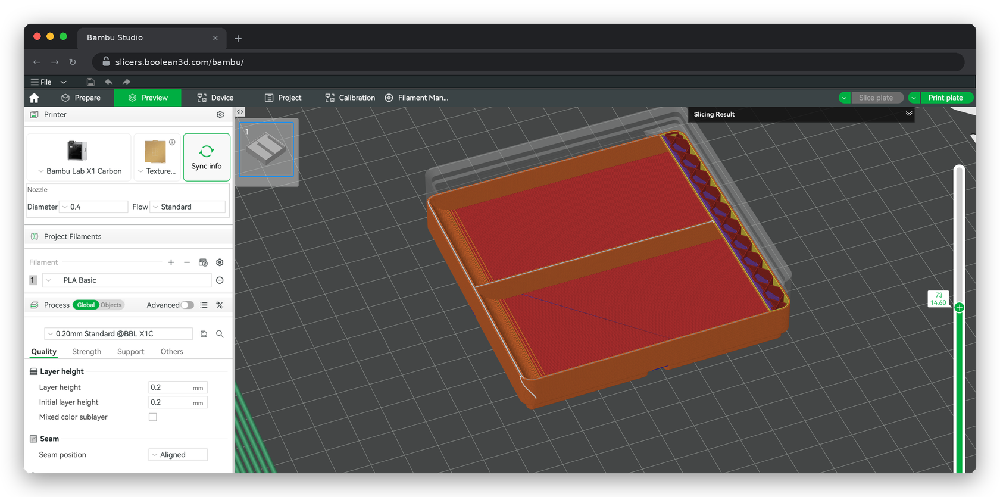

# slicers.wasm

The open-source Bambu Studio, OrcaSlicer and PrusaSlicer, running in your browser. Unofficial: not made or
endorsed by Bambu Lab, the OrcaSlicer team or Prusa.



The full desktop Bambu Studio, OrcaSlicer and PrusaSlicer, running in a browser tab. Unofficial.

The three desktop 3D-printing slicers, compiled to WebAssembly from their own released source code, run as a web
page. Nothing to install: open the page, wait for the download, and the normal program appears in the tab, with its
own menus, settings and printer profiles. It slices on your own computer, inside the tab; nothing of yours is
uploaded to slice.

**Try it:** _live address goes here_

This repository is the complete source of those browser copies: the slicers' pinned upstream sources, our changes
to them, the build scripts, the tool that packs a build for a web host, a small web server to host it yourself, and
the helper program that lets a browser copy talk to a printer on your own network.

## Who made what

- **Bambu Studio** is made by Bambu Lab, and is based on PrusaSlicer by Prusa Research, which is based on
  Slic3r by Alessandro Ranellucci and the RepRap community. GNU AGPL-3.0.
- **OrcaSlicer** is made by SoftFever and the OrcaSlicer contributors, and is based on Bambu Studio and
  PrusaSlicer. GNU AGPL-3.0.
- **PrusaSlicer** is made by Prusa Research, and is based on Slic3r. GNU AGPL-3.0.
- **wxWidgets** (the window toolkit the three are written with) is made by the wxWidgets team; Bambu Studio and
  OrcaSlicer use OrcaSlicer's copy of it, PrusaSlicer its own. wxWindows Library Licence.
- **The browser port of wxWidgets** was started by Adam Hilss (ahilss/wxWidgets-wasm, the port behind
  Wavacity). We added OpenGL, web pages, tooltips, stored passwords, browser file dialogs and blocking dialogs to
  it, and carried it onto PrusaSlicer's newer wxWidgets.
- **The browser build recipe for the slicing core** comes from the Muon3D slicer engine by Muon 3D
  Technologies Limited (github.com/Muon-3D/muon3d-slicer-engine, GNU AGPL-3.0), which carries work from
  Hiosdra/OrcaWasm.
- **The browser copies** are put together by Boolean3d. What we changed is listed under "Our changes" below.

These browser copies are not made, endorsed or supported by Bambu Lab, by the OrcaSlicer team or by
Prusa Research. For help with the slicers themselves, use their own downloads and forums. We never use their
logos, and we do not call these copies official.

## How it works, in short

Each slicer is compiled with Emscripten into one WebAssembly program (`index.wasm`) plus its resources. wxWidgets
draws every window into the page's canvas (its wasm port), OpenGL goes through WebGL, the slicing threads are
browser threads, and the program's files (settings, printer profiles, your projects) live in the browser's storage.
The program's own network stack keeps working: its connections leave the tab as WebSockets to a small relay on the
page host, which opens them to an allow list of the slicers' profile and model servers only. A printer on your own
network is reached through the helper (below), never through anyone's cloud.

## What is here

| Folder | What |
|---|---|
| `bambu-studio/`, `orcaslicer/`, `prusaslicer/` | One folder per slicer. `browser-build/`: the build recipe (CMake, build scripts) and the small pieces the browser needs (`start-up.js`, `stand-ins/` for desktop-only parts; for PrusaSlicer the build-time source edits in `prusaslicer-source-edits.cmake`). `wxwidgets-opengl/`, `wxwidgets-web/`, `wxwidgets-drawing/`: the browser backends added to wxWidgets. `shared/`: what the three builds share: page scripts, fonts, network relay, slicing thread limit, display scaling, the OCCT build for STEP import. `patches/`: our changes to wxWidgets, to the slicer and to the engine, each against a pinned upstream version |
| `bambu-studio/browser-build/printer-link/`, `orcaslicer/browser-build/printer-link/` | The printer connection in the browser: talks to a Bambu Lab printer on your own network through the helper below, never through Bambu Lab's servers |
| `helper/` | The printer helper (Node, no packages, MIT): runs on a computer on the printer's network |
| `package/` | Packs a build for a web host (compressed files, the headers they must be served with, the loading screen with the credits above) and a small server that hosts the result |
| `docker/` | The build container (Emscripten 6.0.10) |
| `build.sh` | One command from nothing to a built slicer |
| `sync-workbench.sh`, `rename-workbench-files.py` | Refresh a slicer's folder from the workbench its served build is made in (below) |
| `SOURCE.md`, `LICENSING.md` | Every pinned source and library with its licence; which licence covers which file here |

## Build it

You need Linux (x86-64) with Docker, git, curl and unzip, Node.js 22 and about 40 GB of free disk. A Bambu Studio
build from nothing took 16 minutes with 24 jobs on a 56-thread machine; PrusaSlicer builds its own OCCT and takes
longer; expect longer on fewer cores. The build runs inside the container; it downloads every source at a pinned
version and checks the downloads' hashes (`SOURCE.md` lists them all and says which few are pinned by commit
without a hash).

```bash
git clone https://github.com/boolean3d/slicers.wasm.git
cd slicers.wasm
bash build.sh bambu ~/slicers-work/bambu 24        # or: orca, prusa (each its own work dir)
```

The last argument is how many compile jobs to run at once; use the number of cores you have. The build ends with
`built: <work dir>/bgui/bambustudio.html` (OrcaSlicer: `orcaslicer.html`; PrusaSlicer: `<work dir>/pgui/prusa/src/prusaslicer.html`). Run the same command
again after a failure: it keeps what is already downloaded and built.

## Host it yourself

Pack the build (about two minutes), then serve it:

```bash
node package/package.mjs --app bambu --src ~/slicers-work/bambu/bgui --version 2.08.02.61-1 \
  --out ~/slicers-pkg --licence LICENSE --start package/bambu-start.txt --source https://github.com/boolean3d/slicers.wasm
node package/serve-package.mjs ~/slicers-pkg 8800
```

Open **http://localhost:8800/bambu/** in Chrome or Edge. For OrcaSlicer: `--app orca`, its own work dir,
`--start package/orca-start.txt`, `/orca/`; for PrusaSlicer: `--app prusa --src ~/slicers-work/prusa/pgui/prusa/src
--start package/prusa-start.txt`, `/prusa/`. One package can hold all three. The first visit downloads 16 to 28 MB
(the rest comes when the program first needs it); later visits start from the browser's copy.

- The slicers use threads, which a browser allows only on a page that is **cross-origin isolated** and **secure**:
  `package.mjs` writes the headers every response must carry (`headers.txt`, `manifest.json`), and the page must be
  opened as `http://localhost` or over `https://`. From another computer, put the server behind HTTPS.
- `serve-package.mjs` is also the slicers' **network relay**: a page in a browser cannot open the network
  connections a desktop program does, so the slicers' calls to their makers' profile and model servers (printer
  profile updates, Printables, model pictures) go through it, to an allow list of those servers only
  (`relay.mjs`). Without it the slicers still run, offline, with the profiles they ship with.
- Any static host can serve the package itself (each file with the content type, encoding and cache rule in
  `manifest.json`); `package/cloudflare/` holds the rules for Cloudflare R2 as an example. The relay then needs its own
  small Node server at the same address.

## Print from the browser copy (optional)

A browser page cannot find a printer or talk to it. The **helper** does that for the tab: it runs on any computer
on the printer's network that stays on (a Raspberry Pi, a home server, the same computer), and the slicer in the
tab connects to it. It needs Node 18 or newer, and ffmpeg for a Bambu printer's camera.

```bash
node helper/bambu-home/helper.mjs printers   # the Bambu printers heard on this network
node helper/bambu-home/helper.mjs run        # keep it running; the tab connects to ws://<this computer>:8770
```

- **Bambu Lab printers** (Bambu Studio and OrcaSlicer in the tab): put the printer in **LAN-only mode with
  Developer Mode on** (printer screen: Settings > Network / LAN). Then, in the tab, Device > add the printer with
  its access code, as in the desktop program. Sending, the printer's status and its camera go through the helper.
- **Prusa printers and Klipper printers** (PrusaSlicer, OrcaSlicer): give the printer's own address on your network
  (PrusaLink, Moonraker) in the slicer's physical printer settings, as on the desktop. The tab sends the upload to
  that address through the helper (`helper.mjs run` opens the connection on your network for it).
- The slicer in the tab looks for the helper at `ws://localhost:8770`. If the helper runs on another computer, open
  the page as `.../bambu/?bridge=ws://<that computer>:8770` (a page opened over `https://` needs `wss://` there, so
  put the helper behind TLS, or reach it over a private network such as Tailscale, which gives it an `https` name).
- The helper talks only to your printer; nothing goes to the printer's maker or to Boolean3d. Keeping the printer in
  LAN-only mode keeps it off the maker's cloud altogether. (`helper.mjs pair` links the helper to a Boolean3d
  account for printing from elsewhere; not needed here.)

## Our changes

Three kinds. Each is in this repository (`<slicer>/patches/*.patch`, the `orca_gui_patch` lines in
`<slicer>/browser-build/CMakeLists.txt`, `prusaslicer/browser-build/prusaslicer-source-edits.cmake`), each marked
`__EMSCRIPTEN__` so the desktop builds are unchanged:

1. **The browser port.** wxWidgets: windows, drawing, OpenGL through WebGL, web views as frames, file dialogs as the
   browser's own upload and download, tooltips, stored passwords kept in the browser's storage, dialogs that wait for
   an answer. The slicers: start-up in a browser (fonts, settings folder in the browser's storage), slicing threads
   capped at 8 (each one takes memory from the tab's 4 GB), the 3D view at the screen's real scale, web sites open
   in a new browser tab, no app-version check or installer download, STEP import over a browser build of OCCT, the
   vendor presets read from one bundle. The slicing engine: the Muon3D engine's browser build, with the build
   fixes in `<slicer>/patches/muon3d-engine.patch`.
2. **The makers' cloud removed.** No sign-in to a Bambu Lab, OrcaSlicer or Prusa account (a password for another
   service never passes through our site; Bambu's sign-in also needs its closed network plug-in, which the browser
   copy never has), no Bambu client identity headers on network calls, no telemetry or "send system info" page, no
   store or MakerWorld pages, nothing reaches the printer makers' servers from the page. Bambu Lab's logos are
   taken out of the Bambu Studio build's images and web pages, and out of the Bambu images OrcaSlicer carries
   (`bambu-studio/browser-build/remove-maker-branding.py`); the plain-text credit to Bambu Lab stays. The programs' own names, screens, printer
   names and bed drawings are left as they are.
3. **Our own LAN printer link.** Bambu Studio's and OrcaSlicer's printer connection (`<slicer>/browser-build/printer-link/`) replaces
   Bambu's closed network plug-in with one that talks only to a printer on your own network, through the helper;
   PrusaLink and Moonraker uploads reach the printer's own address the same way.

## Licence

The slicers and our changes to them are under the GNU Affero General Public License, version 3 (`LICENSE`). If you
host a browser copy for others, the AGPL asks you to offer them its source: the loading screen links to it
(`--source`). Our changes to wxWidgets are under the wxWindows Library Licence, like wxWidgets itself. The helper is
MIT (`helper/LICENSE`). Details per file in `LICENSING.md`; every pinned source and library in `SOURCE.md`.

"Bambu Studio", "Bambu Lab", "OrcaSlicer", "PrusaSlicer" and "Prusa" are their owners' names, used here only to say
what the programs are.
